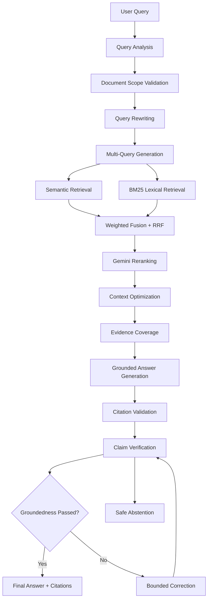
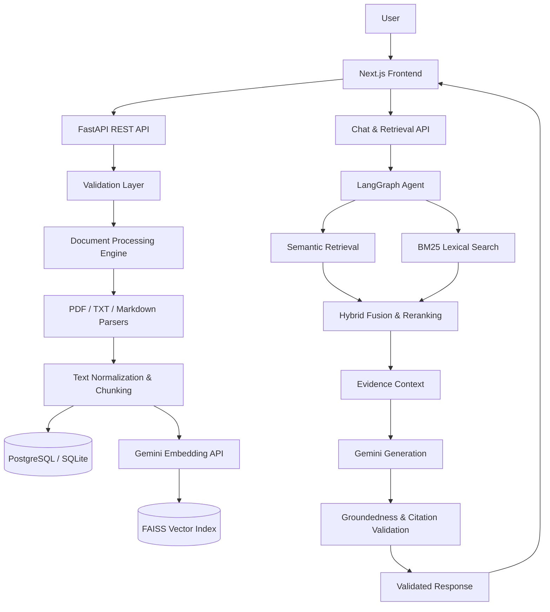

# 🧠 NexaMind AI

### Agentic RAG-Powered Document Intelligence & Knowledge Retrieval Platform

<p align="center">
  
  
  
  
  
</p>

<p align="center">
  <strong>Transform Documents Into Intelligence.</strong><br/>
  Upload. Understand. Retrieve. Reason. Discover.
</p>

<p align="center">
  <a href="https://nexamind-frontend.onrender.com/dashboard">🌐 Live Application</a> •
  <a href="https://github.com/riyasingh006/NexaMind-AI">💻 Source Code</a> •
  <a href="https://nexamind-backend-zvuc.onrender.com/docs">📚 API Documentation</a>
</p>

---

## 🚀 Overview

**NexaMind AI** is an advanced AI-powered document intelligence platform that transforms static documents into an interactive, searchable knowledge base using Retrieval-Augmented Generation (RAG), semantic search, hybrid retrieval, and agentic AI orchestration.

Instead of manually navigating hundreds of pages to find specific information, users can upload their documents and interact with their content through natural-language conversations.

The platform processes PDF, TXT, and Markdown files through an intelligent ingestion pipeline, generates semantic embeddings, builds a FAISS vector index, retrieves relevant evidence, and uses Google Gemini to generate context-aware responses.

Powered by **LangGraph**, NexaMind AI orchestrates a multi-stage reasoning and retrieval workflow with evidence evaluation, citation validation, and groundedness verification.

### ✨ The Core Idea

> Convert unstructured documents into structured, searchable knowledge and make that knowledge accessible through intelligent AI conversations.

---

## 🎯 Project Vision & Objectives

The primary objective of NexaMind AI is to reduce the time and complexity involved in understanding large collections of documents.

### Problems It Addresses

* 📄 Manually searching through lengthy documents is time-consuming.
* 🔍 Traditional keyword search often misses contextually relevant information.
* 🧩 Information distributed across multiple document sections is difficult to connect.
* 🤖 General-purpose AI assistants may generate answers unsupported by the user's documents.
* 📚 Managing and retrieving knowledge from multiple files can become inefficient.

### Our Approach

NexaMind AI combines document processing, semantic understanding, intelligent retrieval, and grounded AI generation into one integrated platform.

| Challenge                       | NexaMind AI Solution                              |
| ------------------------------- | ------------------------------------------------- |
| Large documents                 | Automated text extraction and chunking            |
| Difficult information discovery | Semantic and lexical search                       |
| Contextual search limitations   | Hybrid retrieval and multi-query search           |
| Irrelevant search results       | Fusion, reranking, and context optimization       |
| Unsupported AI answers          | Evidence-based generation and groundedness checks |
| Repeated conversations          | Persistent conversation history                   |
| Complex document collections    | Centralized document workspace                    |

---

# 🌟 Key Features

## 📂 1. Intelligent Document Ingestion

Upload and process multiple document formats through a structured ingestion pipeline.

**Supported formats:**

* PDF
* TXT
* Markdown (`.md`, `.markdown`)

**Capabilities:**

* File extension and MIME validation.
* File signature verification.
* Binary and empty-file detection.
* Maximum upload-size enforcement.
* SHA-256 duplicate detection.
* Filename sanitization.
* Document metadata persistence.
* Processing-state tracking.
* Detailed error reporting.

Each document receives a unique server-generated identifier and is processed through the backend pipeline.

## ⚙️ 2. Advanced Document Processing

The document processing engine converts uploaded files into normalized, structured text.

**Processing stages:**

1. File validation.
2. Secure staging.
3. Content extraction.
4. Text normalization.
5. Structure-aware preprocessing.
6. Recursive or structure-based chunking.
7. Metadata generation.
8. Database persistence.
9. Embedding generation.
10. Vector indexing.

### Advanced Chunking

Documents are divided into smaller text segments called chunks.

Configured defaults:

| Parameter          |           Value |
| ------------------ | --------------: |
| Target Chunk Size  | 1000 characters |
| Chunk Overlap      |  150 characters |
| Minimum Chunk Size |  100 characters |
| Maximum Chunk Size | 2000 characters |
| Chunking Strategy  |            Auto |

Supported chunking strategies:

* **Structure-aware chunking:** Preserves headings, sections, page boundaries, and content blocks.
* **Recursive chunking:** Splits oversized content while maintaining controlled overlap.

Chunk metadata preserves document identity, page information, section hierarchy, offsets, and content characteristics.

## 🧬 3. Gemini-Powered Semantic Embeddings

NexaMind AI uses Google's Gemini embedding model:

`gemini-embedding-001`

Every processed chunk is converted into a 768-dimensional numerical vector using the configured embedding dimension.

**Embedding capabilities:**

* Semantic representation of document content.
* Retrieval-oriented embedding task types.
* Batch embedding generation.
* Vector dimension validation.
* L2 normalization.
* Retry handling for transient provider failures.
* Embedding status tracking.

This enables the platform to identify semantically related content rather than depending exclusively on exact keyword matches.

## ⚡ 4. FAISS Vector Search Engine

The platform uses **FAISS (Facebook AI Similarity Search)** for efficient vector similarity search.

### Technical Implementation

* `faiss-cpu`
* `IndexFlatIP`
* Normalized `float32` vectors.
* Inner-product similarity over normalized vectors.
* Chunk-to-document metadata mapping.
* Scoped document retrieval.
* Index rebuilding and backups.
* Checksummed and atomic index writes.

### Why FAISS?

FAISS enables efficient similarity comparisons between query embeddings and document embeddings.

For example:

**Document content:**

"Machine Learning enables computer systems to learn patterns from data."

**User query:**

"How do computers improve through experience?"

Although the wording is different, semantic similarity can help retrieve the relevant document content.

## 🔎 5. Advanced Hybrid Retrieval

NexaMind AI implements a hybrid retrieval architecture that combines multiple information retrieval techniques.

### Retrieval Components

| Component              | Purpose                                                  |
| ---------------------- | -------------------------------------------------------- |
| Semantic Search        | Retrieves content using embedding similarity             |
| BM25 Search            | Retrieves content using lexical relevance                |
| Multi-Query Retrieval  | Searches using multiple query variations                 |
| Weighted Fusion        | Combines normalized retrieval scores                     |
| Reciprocal Rank Fusion | Combines ranked candidate lists                          |
| Gemini Reranking       | Reorders candidates using structured AI evaluation       |
| Deterministic Fallback | Preserves real fusion-based ranking when reranking fails |
| Neighbor Expansion     | Optionally includes adjacent chunks                      |
| Context Optimization   | Removes duplication and manages context limits           |

### Configured Retrieval Weights

| Retrieval Strategy     | Weight |
| ---------------------- | -----: |
| Semantic Search        |   0.45 |
| Lexical Search         |   0.30 |
| Reciprocal Rank Fusion |   0.25 |

The hybrid pipeline aims to improve retrieval relevance by combining semantic meaning, keyword matching, and ranking information.

## 🧠 6. Agentic AI with LangGraph

The intelligence layer is orchestrated using **LangGraph**.

Instead of executing a single retrieval-and-generation operation, the agent coordinates multiple processing stages.

### Agent Responsibilities

* Query intent analysis.
* Conversation-context understanding.
* Document-scope validation.
* Query rewriting.
* Multi-query generation.
* Hybrid evidence retrieval.
* Candidate reranking.
* Context preparation.
* Evidence coverage analysis.
* Grounded response generation.
* Citation validation.
* Claim-level verification.
* Bounded answer correction.
* Safe abstention.

### Agentic Workflow



## 🛡️ 7. Groundedness Validation & Citation Verification

Reliability is a key design objective.

NexaMind AI is designed to ensure that generated responses are supported by retrieved document evidence.

### Validation Mechanisms

* Evidence coverage evaluation.
* Query-term coverage.
* Citation-label validation.
* Claim-level evidence verification.
* Instruction-leakage rejection.
* Groundedness threshold checks.
* Bounded correction attempts.
* Safe abstention when evidence is insufficient.

### Citation Format

Retrieved evidence is represented using source labels:

`[S1]`, `[S2]`, `[S3]`

Only validated source labels are permitted in the final answer.

**Important:** Groundedness validation is implemented, but successful live production verification remains dependent on Gemini generation and verifier availability. The deployed chat workflow must pass an end-to-end citation test before being considered production-ready.

## 💬 8. Real-Time AI Chat with SSE

The platform provides a conversational interface connected to the actual backend LangGraph workflow.

**Features:**

* Natural-language document queries.
* Server-Sent Events (SSE).
* Streaming workflow and answer-token events.
* Groundedness status reporting.
* Source and citation rendering.
* Conversation persistence.
* Previous conversation retrieval.
* Document-scoped conversations.

**Primary endpoints:**

* `POST /api/v1/chat/query`
* `POST /api/v1/chat/stream`

Both endpoints use the same grounded LangGraph workflow.

## 🗃️ 9. Persistent Conversation Management

Conversation data is managed through the database layer.

Users can:

* Create and continue conversations.
* Retrieve previous conversation history.
* Load individual conversation details.
* Persist user and assistant messages.
* Delete conversations.

Conversation metadata can retain citations, retrieval information, and agent workflow details.

## 📊 10. System Health & Retrieval Analytics

NexaMind AI provides system monitoring and operational visibility.

### System Health

The platform reports component status for:

* FastAPI backend.
* Database connectivity.
* Gemini generation.
* Gemini embeddings.
* FAISS vector index.
* Document processing.
* LangGraph workflow.

### Retrieval Analytics

Available analytics include:

* Document counts.
* Chunk statistics.
* Embedding status.
* Vector index statistics.
* Persisted query counts.
* Document processing statistics.
* Retrieval inspection information.

Detailed per-query latency distributions are not currently implemented.

---

# 🏗️ System Architecture

NexaMind AI follows a modular frontend-backend architecture.



### Architecture Highlights

* Modular FastAPI backend.
* Typed request and response schemas.
* Asynchronous SQLAlchemy database access.
* Independent document-processing services.
* Separate embedding and vector-index services.
* LangGraph-based orchestration.
* Repository-based persistence.
* Centralized exception handling.
* Structured logging.
* Configurable environment-based deployment.

---

# 💻 Technology Stack

## Frontend

| Technology     | Usage                     |
| -------------- | ------------------------- |
| Next.js 16     | Application framework     |
| React 19       | Component-based UI        |
| TypeScript     | Static typing             |
| Tailwind CSS 4 | Styling and responsive UI |

## Backend

| Technology         | Usage                          |
| ------------------ | ------------------------------ |
| Python 3.11+       | Core backend language          |
| FastAPI            | REST API framework             |
| Uvicorn            | ASGI server                    |
| Pydantic v2        | Data validation                |
| SQLAlchemy         | Async ORM                      |
| PostgreSQL         | Production relational database |
| SQLite             | Local development and tests    |
| asyncpg            | Async PostgreSQL driver        |
| PyMuPDF            | PDF extraction                 |
| markdown-it-py     | Markdown parsing               |
| charset-normalizer | Text encoding detection        |

## AI & Retrieval

| Technology             | Usage                    |
| ---------------------- | ------------------------ |
| Google Gemini          | AI generation            |
| gemini-embedding-001   | Semantic embeddings      |
| LangGraph              | Agent orchestration      |
| FAISS                  | Vector similarity search |
| BM25                   | Lexical retrieval        |
| Reciprocal Rank Fusion | Ranking fusion           |
| NumPy                  | Vector operations        |

## DevOps & Testing

| Technology | Usage                  |
| ---------- | ---------------------- |
| Git        | Version control        |
| GitHub     | Source code management |
| Render     | Application deployment |
| Pytest     | Backend testing        |
| HTTPX      | API testing            |
| ESLint     | Frontend linting       |
| TypeScript | Frontend type checking |

---

# 📁 Project Structure

```text
NexaMind-AI/
│
├── backend/
│   ├── app/
│   │   ├── agent/
│   │   │   ├── graph.py
│   │   │   ├── nodes/
│   │   │   ├── prompts/
│   │   │   ├── services/
│   │   │   └── utils/
│   │   │
│   │   ├── api/
│   │   │   └── routes/
│   │   │
│   │   ├── core/
│   │   │   ├── config.py
│   │   │   ├── errors.py
│   │   │   └── logging.py
│   │   │
│   │   ├── database/
│   │   ├── evaluation/
│   │   ├── models/
│   │   ├── processing/
│   │   ├── repositories/
│   │   ├── retrieval/
│   │   ├── schemas/
│   │   ├── services/
│   │   └── utils/
│   │
│   ├── data/
│   ├── logs/
│   ├── storage/
│   │   └── faiss/
│   │
│   ├── tests/
│   ├── .env.example
│   ├── requirements.txt
│   └── README.md
│
├── src/
│   ├── app/
│   │   └── dashboard/
│   ├── components/
│   ├── lib/
│   └── types/
│
├── public/
├── package.json
├── tsconfig.json
└── README.md
```

*The structure above is a logical overview; individual files may differ as the implementation evolves.*

---

# ⚙️ Installation & Local Setup

## Prerequisites

Install the following:

* Python 3.11 or newer.
* Node.js compatible with the Next.js project.
* npm.
* Git.
* Google Gemini API key.
* PostgreSQL for local PostgreSQL development, if required.

## 1. Clone Repository

```bash
git clone https://github.com/riyasingh006/NexaMind-AI.git

cd NexaMind-AI
```

## 2. Frontend Setup

```bash
npm install
```

Create a `.env.local` file in the repository root:

```env
NEXT_PUBLIC_API_BASE_URL=http://localhost:8000/api/v1
```

Start the frontend:

```bash
npm run dev
```

Frontend:

`http://localhost:3000`

## 3. Backend Setup

Open a terminal in the repository root:

```powershell
cd backend

python -m venv .venv

.\.venv\Scripts\Activate.ps1

python -m pip install -r requirements.txt
```

Create the local environment file:

```powershell
Copy-Item .env.example .env
```

Configure the required environment variables.

### Essential Configuration

```env
APP_ENV=development
DEBUG=true

DATABASE_URL=sqlite+aiosqlite:///./data/documind.db

FRONTEND_URL=http://localhost:3000

DOCUMIND_GEMINI_API_KEY=YOUR_GEMINI_API_KEY

GEMINI_GENERATION_MODEL=gemini-3.6-flash

GEMINI_EMBEDDING_MODEL=gemini-embedding-001

GEMINI_EMBEDDING_DIMENSION=768

FAISS_DIR=./storage/faiss
```

**Security:** Never commit `.env`, API keys, database credentials, or other secrets to GitHub.

Start the backend:

```powershell
uvicorn app.main:app --reload --host 0.0.0.0 --port 8000
```

Backend:

`http://localhost:8000`

Swagger documentation:

`http://localhost:8000/docs`

---

# 🔌 API Reference

Base API prefix:

`/api/v1`

## Health & System

| Method | Endpoint         | Description                      |
| ------ | ---------------- | -------------------------------- |
| GET    | `/health`        | Database-aware health status     |
| GET    | `/health/live`   | Process liveness                 |
| GET    | `/health/ready`  | Application readiness            |
| GET    | `/system/status` | Component and integration status |

## Document Management

| Method | Endpoint                       | Description                            |
| ------ | ------------------------------ | -------------------------------------- |
| POST   | `/documents/upload`            | Upload and process document            |
| GET    | `/documents`                   | List documents                         |
| GET    | `/documents/{id}`              | Document details                       |
| GET    | `/documents/{id}/status`       | Processing status                      |
| GET    | `/documents/{id}/chunks`       | Retrieve document chunks               |
| GET    | `/documents/{id}/content`      | Extracted document content             |
| POST   | `/documents/{id}/reprocess`    | Reprocess document                     |
| POST   | `/documents/{id}/index`        | Generate document embeddings and index |
| GET    | `/documents/{id}/index/status` | Document indexing status               |
| DELETE | `/documents/{id}`              | Delete document                        |

## Embeddings & Vector Search

| Method | Endpoint                 | Description                        |
| ------ | ------------------------ | ---------------------------------- |
| POST   | `/embeddings/generate`   | Generate embeddings                |
| GET    | `/embeddings/status`     | Embedding configuration and status |
| GET    | `/vectors/index/status`  | FAISS index status                 |
| POST   | `/vectors/search`        | Vector similarity search           |
| POST   | `/vectors/index/rebuild` | Rebuild vector index               |
| GET    | `/vectors/statistics`    | Vector statistics                  |

## Retrieval & Evaluation

| Method | Endpoint                   | Description              |
| ------ | -------------------------- | ------------------------ |
| POST   | `/retrieval/inspect`       | Inspect hybrid retrieval |
| POST   | `/evaluation/groundedness` | Evaluate groundedness    |

## AI Chat

| Method | Endpoint                   | Description                  |
| ------ | -------------------------- | ---------------------------- |
| POST   | `/chat/query`              | Execute grounded AI query    |
| POST   | `/chat/stream`             | Stream AI workflow using SSE |
| GET    | `/chat/conversations`      | List conversations           |
| GET    | `/chat/conversations/{id}` | Retrieve conversation        |
| DELETE | `/chat/conversations/{id}` | Delete conversation          |

## Analytics

| Method | Endpoint               | Description          |
| ------ | ---------------------- | -------------------- |
| GET    | `/analytics/dashboard` | Dashboard statistics |
| GET    | `/analytics/retrieval` | Retrieval analytics  |
| GET    | `/analytics/documents` | Document statistics  |

For request parameters and response schemas, open the interactive Swagger documentation.

---

# 🧪 Testing & Quality Assurance

NexaMind AI includes automated backend and frontend validation.

### Backend Tests

Run from the backend directory:

```powershell
python -m pytest -q
```

Coverage includes:

* File validation and upload.
* PDF, TXT, and Markdown parsing.
* Text normalization and chunking.
* Duplicate document detection.
* Database persistence.
* Gemini embedding behaviour.
* FAISS indexing and recovery.
* Semantic and lexical retrieval.
* Hybrid fusion and reranking.
* Citation validation.
* Groundedness evaluation.
* LangGraph execution.
* Conversation persistence.
* API errors and health checks.

### Frontend Validation

Run from the repository root:

```bash
npx tsc --noEmit

npm run lint

npm run build
```

### Production Verification

The project has undergone a production smoke test covering:

* PDF upload.
* Text extraction.
* Chunk generation.
* Gemini embedding generation.
* FAISS indexing and retrieval.
* Conversation history persistence.

**Verification boundary:** Live groundedness validation and citation delivery remain pending successful end-to-end production verification.

---

# ☁️ Deployment Architecture

The application is deployed using Render.

| Component     | Deployment           |
| ------------- | -------------------- |
| Frontend      | Render Web Service   |
| Backend       | Render Web Service   |
| Database      | Render PostgreSQL    |
| AI Generation | Google Gemini API    |
| Embeddings    | Gemini Embedding API |
| Vector Search | FAISS                |

### Production Environment Variables

Frontend:

```env
NEXT_PUBLIC_API_BASE_URL=https://nexamind-backend-zvuc.onrender.com/api/v1
```

Backend:

```env
FRONTEND_URL=https://nexamind-frontend.onrender.com
```

Alternatively, configure:

```env
CORS_ORIGINS=https://nexamind-frontend.onrender.com
```

When `CORS_ORIGINS` is configured, it takes precedence over `FRONTEND_URL`.

Keep the existing production database URL and Gemini API secret in Render's environment settings.

### ⚠️ Persistent Storage Considerations

FAISS indexes, uploaded documents, extracted text, and processing files use filesystem storage.

Render's ordinary service filesystem must not be assumed durable across deployments or restarts.

A confirmed persistent disk is required for durable local-file storage. Configure the following directories under its mount path:

* `STORAGE_DIR`
* `EXTRACTED_DIR`
* `PROCESSING_TEMP_DIR`
* `FAISS_DIR`

The actual mount path and disk configuration must be verified in the Render dashboard.

---

# 🔐 Security & Reliability

Security and operational reliability are important parts of the architecture.

### Implemented Protections

* API keys stored using secret-aware configuration.
* Secrets excluded from application responses and logs.
* File extension and MIME validation.
* File signature verification.
* SHA-256 duplicate detection.
* Server-generated storage filenames.
* Atomic upload and index operations.
* SQLAlchemy parameterized database operations.
* Typed API errors.
* Request ID tracking.
* Controlled CORS origins.
* Groundedness validation.
* Safe abstention when evidence is insufficient.

### Known Limitations

The following capabilities are not currently implemented:

* User authentication.
* Role-based authorization.
* Multi-tenant isolation.
* Malware scanning.
* OCR for image-only PDFs.
* Production database migration tooling.
* Background document-indexing workers.

These limitations should be considered before exposing the service to multiple untrusted users or sensitive production workloads.

---

# 🗺️ Development Roadmap

NexaMind AI is designed to evolve into a more comprehensive document intelligence platform.

| Feature                             | Status                                          |
| ----------------------------------- | ----------------------------------------------- |
| Document ingestion                  | Implemented                                     |
| PDF/TXT/Markdown parsing            | Implemented                                     |
| Structure-aware chunking            | Implemented                                     |
| Gemini embeddings                   | Implemented                                     |
| FAISS vector indexing               | Implemented                                     |
| BM25 lexical retrieval              | Implemented                                     |
| Hybrid retrieval                    | Implemented                                     |
| Multi-query retrieval               | Implemented                                     |
| RRF fusion                          | Implemented                                     |
| Gemini reranking                    | Implemented with deterministic fallback         |
| LangGraph orchestration             | Implemented                                     |
| SSE chat streaming                  | Implemented                                     |
| Groundedness validation             | Implemented; live verification pending          |
| Citation validation                 | Implemented; live delivery pending verification |
| Persistent PostgreSQL conversations | Implemented                                     |
| Production storage durability       | Requires Render disk verification               |
| Authentication and authorization    | Planned                                         |
| OCR integration                     | Planned                                         |
| Background processing workers       | Planned                                         |
| Database migrations                 | Planned                                         |
| Advanced retrieval evaluation       | Planned                                         |

---

# 💡 Potential Use Cases

### 🎓 Education & Learning

* Search academic notes.
* Understand lengthy study material.
* Ask questions about uploaded textbooks.
* Extract important concepts from documents.

### 🔬 Research & Analysis

* Explore research papers.
* Retrieve relevant findings.
* Search across multiple technical documents.
* Identify evidence supporting specific claims.

### 🏢 Enterprise Knowledge Management

* Search internal documentation.
* Explore company policies.
* Retrieve information from employee handbooks.
* Build centralized knowledge repositories.

### 📑 Documentation Intelligence

* Analyze technical documentation.
* Search project specifications.
* Explore software manuals.
* Retrieve relevant implementation details.

---

# 🏆 Engineering Highlights

The project demonstrates practical implementation of several advanced software engineering and AI concepts:

* End-to-end RAG architecture.
* Agentic workflow orchestration.
* Semantic and lexical retrieval.
* Vector similarity search.
* Embedding-based document representation.
* Structured AI reranking.
* Evidence-grounded response generation.
* Claim-level validation.
* Asynchronous API and database operations.
* Modular backend architecture.
* Real-time SSE communication.
* Production deployment configuration.
* Automated testing and error handling.

---

# 👩‍💻 Author

<p align="center">
  <strong>Riya Singh</strong><br/>
  BCA – Artificial Intelligence & Machine Learning
</p>

<p align="center">
  <a href="https://github.com/riyasingh006">
    
  </a>
</p>

---

# ⭐ Support the Project

If you find NexaMind AI interesting, consider:

* ⭐ Starring the repository.
* 🍴 Forking the project.
* 🐛 Reporting issues.
* 💡 Suggesting improvements.
* 🤝 Contributing to future development.

<p align="center">
  <strong>Built to make knowledge more accessible, searchable, and intelligent.</strong>
</p>

<p align="center">
  🧠 <strong>NexaMind AI</strong> — From Documents to Intelligence.
</p>
