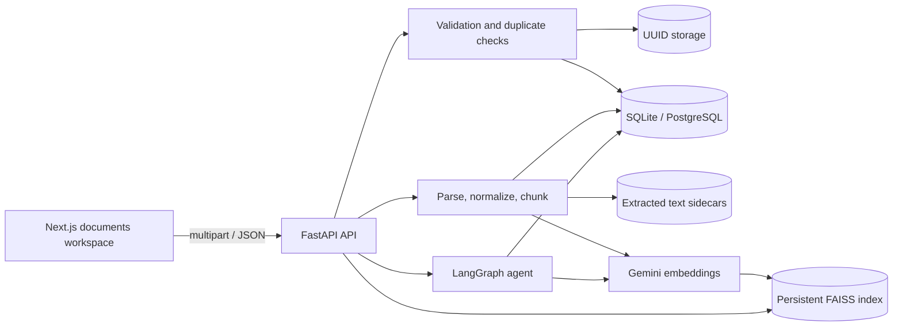
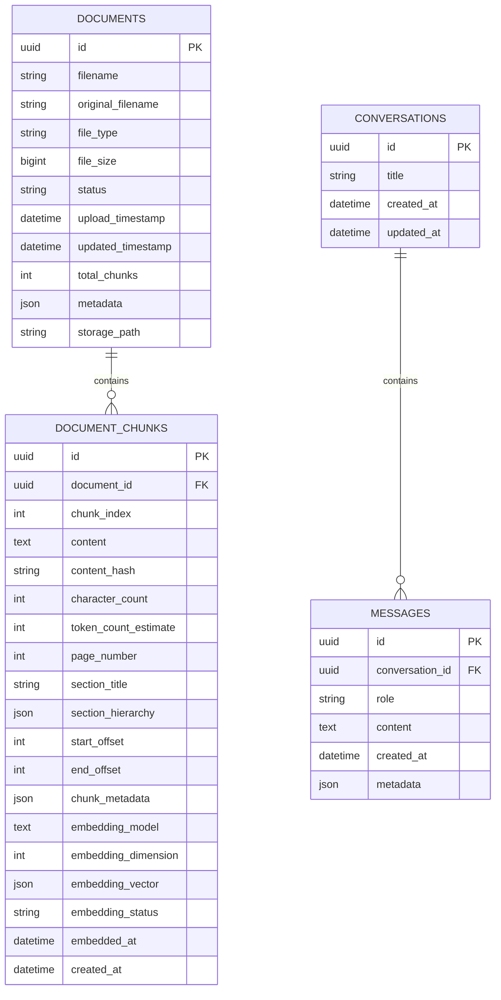

# DocuMind AI Backend

Phase 6 backend for the DocuMind AI document intelligence workspace. The service validates, parses, normalizes, chunks, embeds, indexes, and retrieves real PDF, TXT, and Markdown content through a typed FastAPI API. Gemini `gemini-embedding-001` vectors are persisted in a local FAISS index, and a LangGraph agent generates citation-validated answers with hybrid multi-query retrieval, Gemini reranking, evidence coverage, and claim-level groundedness verification.

> **Implementation boundary:** Phase 6 implements real multi-query semantic plus BM25 retrieval, normalized weighted fusion, Reciprocal Rank Fusion (RRF), structured Gemini reranking with deterministic fallback, optional neighbor expansion, context optimization, evidence coverage, and bounded groundedness correction. `POST /api/v1/chat/stream` remains an integration-status placeholder and does not stream tokens. Retrieval analytics continue to report aggregate persisted query counts without per-query latency distributions.

## Stack

| Layer | Technology |
| --- | --- |
| Runtime | Python 3.11+ |
| API | FastAPI, Uvicorn |
| Validation | Pydantic v2, pydantic-settings |
| Persistence | SQLAlchemy 2.0+ async ORM, SQLite via aiosqlite |
| PDF parsing | PyMuPDF |
| Markdown parsing | markdown-it-py |
| Text decoding | charset-normalizer |
| Embeddings | `google-genai`, `gemini-embedding-001` |
| Generation | `google-genai`, `gemini-3.6-flash` by default |
| Orchestration | LangGraph (`langgraph==1.2.19`) |
| Vector search | FAISS (`faiss-cpu`, flat inner product over normalized vectors) |
| Numerics | NumPy |
| Testing | Pytest, pytest-asyncio, HTTPX |
| Logging | Python logging, JSON formatter, rotating file handler |
| Storage | Local filesystem for source files, extracted text, and the FAISS index |

SQLite is the development database. Models use portable SQLAlchemy types, UUIDs, foreign keys, and timezone-aware UTC handling. The repository and service layers are structured for an async PostgreSQL deployment.

## Processing Pipeline

```text
Upload
  -> validate extension, MIME, signature, size, binary content, and checksum
  -> stage file and reject duplicate SHA-256
  -> persist document and move file to UUID storage path
  -> parse PDF / TXT / Markdown
  -> normalize text while preserving structure
  -> build structure-aware or recursive chunks
  -> replace persisted chunks atomically
  -> write extracted raw and normalized text sidecars
  -> embed chunks with gemini-embedding-001 when configured
  -> upsert L2-normalized vectors into the persistent FAISS index
  -> mark indexed/COMPLETED or failed with actionable details
```

Embedding runs synchronously after processing by default (`VECTOR_INDEX_AUTO_ON_UPLOAD`). It can also be triggered explicitly per document. If `DOCUMIND_GEMINI_API_KEY` is absent, chunking still succeeds and document indexing is reported as `NOT_CONFIGURED` with a `503` for embedding requests.

Processing orchestration is synchronous from the upload and reprocess requests. Parsing, preprocessing, and chunking run in a worker thread with a configurable timeout. Failed processing preserves existing chunks when re-processing an indexed document.

## Agentic RAG Pipeline

```text
Chat request
  -> require configured Gemini generation key
  -> validate selected documents exist and are indexed
  -> create or load conversation, then persist the user message
  -> analyze query intent and conversation context
  -> validate document scope
  -> rewrite query when needed
  -> generate scoped retrieval queries
  -> run semantic FAISS search and BM25 lexical search per query
  -> normalize weighted semantic/lexical scores and fuse with RRF
  -> rerank fused candidates with structured Gemini output
  -> fall back to deterministic fusion scores if reranking fails
  -> optionally expand adjacent neighbor chunks
  -> optimize, deduplicate, and budget the answer context
  -> grade evidence and compute query-term coverage
  -> generate a structured grounded answer from supplied context
  -> validate evidence citations and reject leaked instructions
  -> verify individual claims against cited evidence
  -> regenerate once when groundedness is below threshold
  -> finalize citations or abstain safely
  -> persist the assistant message with citations and workflow metadata
```

Hybrid retrieval is scoped to the selected indexed documents. Lexical search uses BM25 over persisted chunk text; semantic search uses the local FAISS index. If Gemini reranking is unavailable, retrieval continues with real fusion scores instead of fabricated relevance. Neighbor expansion can add adjacent chunk text to the context while the parent chunk keeps its measured score.

The agent never invents an answer when retrieval is unavailable or evidence is insufficient. Citation labels use `[S1]`, `[S2]`, and so on, and only supplied labels survive validation. Claim verification requires valid cited evidence for supported claims. App-level generation failures map to typed errors: `503 GEMINI_NOT_CONFIGURED`, `504 GEMINI_TIMEOUT`, `429 GEMINI_RATE_LIMITED`, `502 GEMINI_RESPONSE_INVALID`, and `503 GEMINI_UNAVAILABLE`.



## Document Status Contract

The legacy document status values remain unchanged for frontend and chat compatibility:

`queued`, `processing`, `indexed`, `failed`

Detailed processing states are exposed separately:

`UPLOADED`, `VALIDATING`, `EXTRACTING`, `PREPROCESSING`, `CHUNKING`, `EMBEDDING`, `VECTOR_INDEXING`, `COMPLETED`, `FAILED`, `REQUIRES_OCR`

Document-level indexing state is tracked independently:

`NOT_CONFIGURED`, `NOT_INDEXED`, `EMBEDDING`, `VECTOR_INDEXING`, `INDEXED`, `FAILED`, `STALE`

Successful ingestion uses coarse status `indexed` with detailed state `COMPLETED`. Image-only PDFs use coarse status `failed` with detailed state `REQUIRES_OCR`. A document can be chunked and persisted while its vector index state remains `NOT_CONFIGURED` or `NOT_INDEXED`. OCR is detected and reported but is not implemented.

## Data Model



Deleting a document cascades to its chunks and removes the stored source and extracted sidecars. Token counts are estimates using `characters_div_4_estimate`.

Each persisted chunk's `metadata` includes:

- `chunk_id`, `document_id`, `filename`, and `source_type`
- `strategy`, `page_number_end`, `block_kinds`, `segment_count`
- `contains_overlap` and `token_count_method`

Embedding vectors are persisted as JSON for portability and rebuilt into the FAISS index on startup or rebuild. The FAISS metadata maps vector positions to chunk IDs and document IDs; SQLAlchemy chunk rows remain authoritative. A lightweight SQLite startup migration adds the embedding columns without requiring Alembic.

## Project Structure

```text
backend/
  app/
    agent/               LangGraph state, graph, service, nodes, prompts, utilities
    api/routes/          health, documents, embeddings, vectors, chat, analytics, system, retrieval, evaluation
    core/                config, errors, logging, middleware
    database/            async session, model base, SQLite startup migration
    evaluation/          claim splitting and groundedness verification
    models/              document, document_chunk, conversation, message
    processing/          models, validation, parsers, preprocessing, chunking
    repositories/        document, document chunk, conversation persistence
    retrieval/           BM25, coverage, optimizer, reranker, advanced pipeline
    schemas/             typed API contracts
    services/            document, processing, gemini embedding, vector index, indexing, chat, analytics, system, retrieval inspection
    utils/               datetime, files, text
  data/                  database, extracted text, processing temp files
  logs/                  rotating JSON logs
  storage/               uploaded source files
    faiss/               index.faiss, metadata, manifest, backups
  tests/
  .env.example
  requirements.txt
  README.md
```

## Setup

Run backend commands from the `backend` directory so relative paths resolve consistently.

```powershell
cd backend
python -m venv .venv
.\.venv\Scripts\Activate.ps1
python -m pip install -r requirements.txt
Copy-Item .env.example .env
uvicorn app.main:app --reload --host 0.0.0.0 --port 8000
```

Local endpoints:

- API root: `http://localhost:8000/`
- Swagger UI: `http://localhost:8000/docs`
- OpenAPI JSON: `http://localhost:8000/openapi.json`
- API prefix: `/api/v1`
- Health: `http://localhost:8000/api/v1/health`

## Frontend Integration

The documents workspace is connected to the backend. From the repository root:

```powershell
npm install
npm run dev
```

The frontend defaults to `http://localhost:8000/api/v1`. Override it with a local, ignored `.env.local` file:

```text
NEXT_PUBLIC_API_BASE_URL=http://localhost:8000/api/v1
```

Connected document operations:

- List and refresh documents
- Upload with real XHR progress and duplicate/validation errors
- Display coarse status, detailed processing state, warnings, and vector indexing state
- View extracted content and document chunks metadata
- Download extracted text
- Reprocess existing documents and rebuild chunks
- Generate or remove document embeddings and vectors
- Build the full or document-filtered FAISS index
- Run retrieval tests with query scope, top-K, threshold, scores, and latency
- Inspect hybrid retrieval traces, semantic/lexical ranks, fusion, rerank fallback warnings, coverage, and neighbors
- Verify candidate-answer claims against cited evidence in the groundedness lab
- Send real chat queries through the LangGraph agent and render grounded citations
- Load and delete persisted chat conversations from the backend
- View live backend and component health

Streaming remains a future integration. The chat UI waits for the complete `/chat/query` response rather than simulating tokens.

## Environment Variables

| Variable | Default | Purpose |
| --- | --- | --- |
| `APP_NAME` | `DocuMind AI API` | Service name |
| `APP_VERSION` | `1.0.0` | API version |
| `APP_ENV` | `development` | `development`, `testing`, or `production` |
| `DEBUG` | `false` | Debug flag |
| `API_V1_PREFIX` | `/api/v1` | Versioned route prefix |
| `DATABASE_URL` | SQLite async URL | SQLAlchemy database URL |
| `DATABASE_ECHO` | `false` | SQL echo logging |
| `DATABASE_POOL_SIZE` | `5` | Non-SQLite pool size |
| `DATABASE_MAX_OVERFLOW` | `10` | Non-SQLite pool overflow |
| `FRONTEND_URL` | `http://localhost:3000` | Allowed CORS origin |
| `LOG_LEVEL` | `INFO` | Root log level |
| `LOG_DIR` | `./logs` | Rotating log directory |
| `STORAGE_DIR` | `./storage` | Uploaded source directory |
| `EXTRACTED_DIR` | `./data/extracted` | Raw and normalized sidecars |
| `PROCESSING_TEMP_DIR` | `./data/tmp` | Atomic processing workspace |
| `MAX_UPLOAD_SIZE` | `26214400` | Maximum bytes per upload (25 MB) |
| `PROCESSING_TIMEOUT_SECONDS` | `120` | Parse and chunk timeout |
| `CHUNK_SIZE` | `1000` | Target chunk characters |
| `CHUNK_OVERLAP` | `150` | Overlap characters |
| `MIN_CHUNK_SIZE` | `100` | Minimum target chunk size |
| `MAX_CHUNK_SIZE` | `2000` | Hard maximum chunk size |
| `CHUNKING_STRATEGY` | `auto` | `auto`, `recursive`, or `structure` |
| `CONTENT_PREVIEW_CHARACTERS` | `800` | Stored document preview length |
| `CONTENT_ENDPOINT_MAX_CHARACTERS` | `50000` | Content response cap |
| `DOCUMIND_GEMINI_API_KEY` | empty | Gemini API key; embeddings are disabled when empty |
| `GEMINI_GENERATION_MODEL` | `gemini-3.6-flash` | Grounded answer generation model |
| `GEMINI_GENERATION_TEMPERATURE` | `0.2` | Generation temperature |
| `GEMINI_GENERATION_TIMEOUT_SECONDS` | `60` | Per-request generation timeout |
| `GEMINI_EMBEDDING_MODEL` | `gemini-embedding-001` | Embedding model |
| `GEMINI_EMBEDDING_DIMENSION` | `768` | Output dimensions, validated from 1 to 3072 |
| `GEMINI_EMBEDDING_BATCH_SIZE` | `32` | Chunks per embedding request |
| `GEMINI_EMBEDDING_TIMEOUT_SECONDS` | `30` | Per-request timeout |
| `GEMINI_EMBEDDING_MAX_RETRIES` | `3` | Retries for transient Gemini failures |
| `GEMINI_EMBEDDING_RETRY_BASE_SECONDS` | `0.5` | Exponential backoff base |
| `FAISS_DIR` | `./storage/faiss` | Persistent index, metadata, manifest, backups |
| `FAISS_BACKUP_COUNT` | `5` | Index backup retention |
| `VECTOR_SEARCH_DEFAULT_TOP_K` | `5` | Default result count |
| `VECTOR_SEARCH_MAX_TOP_K` | `50` | Maximum accepted top-K |
| `VECTOR_SIMILARITY_THRESHOLD` | `0.0` | Default cosine-similarity cutoff |
| `VECTOR_INDEX_AUTO_ON_UPLOAD` | `true` | Embed and index automatically after chunking |
| `DOCUMIND_RAG_TOP_K` | `8` | Evidence chunks requested per agent retrieval |
| `DOCUMIND_RAG_SIMILARITY_THRESHOLD` | `0.35` | Agent retrieval cutoff |
| `DOCUMIND_RAG_MAX_CONTEXT_CHUNKS` | `10` | Maximum chunks placed in the answer context |
| `DOCUMIND_RAG_MAX_CONTEXT_TOKENS` | `12000` | Approximate answer context budget |
| `DOCUMIND_RAG_MAX_RETRIEVAL_QUERIES` | `4` | Maximum rewritten retrieval queries |
| `DOCUMIND_RAG_MULTI_QUERY_ENABLED` | `true` | Enable multi-query retrieval |
| `DOCUMIND_RAG_HYBRID_SEARCH_ENABLED` | `true` | Enable semantic plus BM25 retrieval |
| `DOCUMIND_RAG_SEMANTIC_WEIGHT` | `0.45` | Semantic contribution to normalized fusion |
| `DOCUMIND_RAG_LEXICAL_WEIGHT` | `0.30` | BM25 contribution to normalized fusion |
| `DOCUMIND_RAG_RRF_WEIGHT` | `0.25` | Reciprocal Rank Fusion contribution |
| `DOCUMIND_RAG_RRF_K` | `60` | RRF rank smoothing constant |
| `DOCUMIND_RAG_RERANKING_ENABLED` | `true` | Enable structured Gemini reranking |
| `DOCUMIND_RAG_RERANK_TOP_K` | `10` | Candidates sent to the reranker |
| `DOCUMIND_RAG_FINAL_TOP_K` | `5` | Final chunks after reranking; must not exceed rerank top-K |
| `DOCUMIND_RAG_NEIGHBOR_EXPANSION_ENABLED` | `false` | Add adjacent chunk text to selected evidence |
| `DOCUMIND_GROUNDEDNESS_ENABLED` | `true` | Enable claim-level groundedness verification |
| `DOCUMIND_GROUNDEDNESS_MAX_RETRIES` | `1` | Bounded answer corrections after failed verification |
| `DOCUMIND_GROUNDEDNESS_THRESHOLD` | `0.75` | Minimum groundedness score before correction or abstention |
| `DOCUMIND_AGENT_MAX_RETRIES` | `2` | Answer-validation regeneration retries |
| `DOCUMIND_AGENT_TIMEOUT_SECONDS` | `120` | Full graph execution timeout |

The chunk configuration is validated at startup: `MIN_CHUNK_SIZE <= CHUNK_SIZE <= MAX_CHUNK_SIZE`, and overlap must be smaller than the chunk size.

## API Endpoints

| Method | Path | Behavior |
| --- | --- | --- |
| GET | `/api/v1/health` | Health with live database check |
| GET | `/api/v1/health/ready` | Readiness; 503 when unavailable |
| GET | `/api/v1/health/live` | Process liveness |
| POST | `/api/v1/documents/upload` | Validate, process, chunk, and persist a document |
| GET | `/api/v1/documents` | Paginated list with search, status, and type filters |
| GET | `/api/v1/documents/{id}` | Document metadata and processing summary |
| GET | `/api/v1/documents/{id}/status` | Detailed processing status |
| GET | `/api/v1/documents/{id}/chunks` | Paginated chunks with metadata |
| GET | `/api/v1/documents/{id}/content` | Extracted text with truncation metadata |
| POST | `/api/v1/documents/{id}/reprocess` | Re-run the pipeline on the stored source |
| POST | `/api/v1/documents/{id}/reindex` | Compatibility alias for reprocess; returns 202 |
| POST | `/api/v1/documents/{id}/index?force=false` | Embed chunks and upsert document vectors |
| GET | `/api/v1/documents/{id}/index/status` | Per-document embedding and vector status |
| DELETE | `/api/v1/documents/{id}/index` | Remove a document's vectors from FAISS |
| DELETE | `/api/v1/documents/{id}` | Delete source, sidecars, metadata, chunks, and vectors |
| GET | `/api/v1/documents/processing/statistics` | Processing, chunk, and OCR statistics |
| POST | `/api/v1/embeddings/generate` | Generate embeddings for a document (`document_id`, `force`) |
| GET | `/api/v1/embeddings/status` | Embedding configuration and aggregate chunk status |
| GET | `/api/v1/vectors/index/status` | FAISS status, vector count, version, storage path |
| POST | `/api/v1/vectors/search` | Scoped cosine search with query, document IDs, top-K, threshold |
| POST | `/api/v1/vectors/index/rebuild` | Rebuild the full or document-filtered index |
| GET | `/api/v1/vectors/statistics` | Corpus, embedding, index, and storage statistics |
| POST | `/api/v1/retrieval/inspect` | Inspect hybrid query lanes, fused candidates, reranking, coverage, and final chunks |
| POST | `/api/v1/evaluation/groundedness` | Verify answer claims against retrieved cited evidence |
| POST | `/api/v1/chat/query` | Run the LangGraph agent and persist the grounded answer |
| POST | `/api/v1/chat/stream` | Integration-status SSE placeholder; no tokens |
| GET | `/api/v1/chat/conversations` | Conversation history |
| GET | `/api/v1/chat/conversations/{id}` | Conversation detail |
| DELETE | `/api/v1/chat/conversations/{id}` | Delete conversation and messages |
| GET | `/api/v1/analytics/dashboard` | Persisted document and query counts with retrieval status |
| GET | `/api/v1/analytics/retrieval` | Persisted query count; detailed metrics unavailable |
| GET | `/api/v1/analytics/documents` | Processing and storage statistics |
| GET | `/api/v1/system/status` | Component and integration status |

`/processing/statistics` is registered before `/{document_id}` so it is not interpreted as a UUID.

## Upload and Validation Rules

- Accepted extensions: `.pdf`, `.txt`, `.md`, `.markdown`
- Max size: 25 MB by default
- Generic MIME types are tolerated when the extension is valid
- Explicit MIME mismatches, binary content, bad signatures, empty files, and truncated uploads are rejected
- Filenames are sanitized; stored source names are server-generated UUIDs
- SHA-256 duplicates return `409 DUPLICATE_DOCUMENT`
- Validation failures return `4xx` without creating a document
- Files that pass storage validation but fail parsing become inspectable failed documents

Common codes:

| Status | Code |
| --- | --- |
| 400 | `INVALID_FILENAME`, `FILE_EMPTY`, `MIME_TYPE_MISMATCH`, `FILE_SIGNATURE_MISMATCH`, `INVALID_PDF_SIGNATURE`, `BINARY_CONTENT_REJECTED`, `FILE_TRUNCATED` |
| 409 | `DUPLICATE_DOCUMENT`, `STORED_FILE_MODIFIED`, `DOCUMENT_FILE_MISSING` |
| 413 | `FILE_TOO_LARGE` |
| 415 | `UNSUPPORTED_FILE_TYPE` |

Processing failure codes include `OCR_REQUIRED`, `CORRUPTED_PDF`, `ENCRYPTED_PDF`, `EMPTY_DOCUMENT`, `NO_CHUNKS_CREATED`, `PROCESSING_TIMEOUT`, and `INTERNAL_PROCESSING_ERROR`.

## Parsing and Chunking

- PDF pages are extracted in order with page numbers; encrypted, corrupt, empty, and image-only PDFs are reported explicitly.
- TXT decoding handles BOM, UTF-8, UTF-16, and charset detection.
- Markdown preserves headings, paragraph/list/code/table/blockquote structure, links, and section hierarchy.
- `structure` chunking flushes on headings/pages and respects block boundaries.
- `recursive` chunking splits oversized blocks and applies overlap.
- Small fragments are merged only when doing so does not cross a heading boundary.
- Chunk offsets relate to the normalized document text.
- Raw and normalized sidecars are stored as `{document_id}.raw.txt` and `{document_id}.normalized.txt`.
- `/content` falls back to persisted chunk text when sidecars are unavailable.

## Embeddings and Vector Index

- Documents use Gemini task type `RETRIEVAL_DOCUMENT`; searches use `RETRIEVAL_QUERY`.
- All vectors are validated for expected dimension, emptiness, and non-finite values, then L2-normalized.
- `IndexFlatIP` provides cosine similarity over normalized `float32` vectors.
- The index position map resolves chunk ID -> document ID, while SQLAlchemy chunk rows remain authoritative.
- Index files live in `FAISS_DIR`: `index.faiss`, `index_metadata.json`, and `index_manifest.json`, with rotating backups.
- Writes are atomic and checksummed. Startup can recover from a valid backup if the primary index is corrupted.
- Searches can target all documents, one document, or multiple document IDs without returning unrelated chunks.
- Reprocessing a document clears its previous vectors before rebuilding; deletion removes vectors and refreshes the manifest.
- Gemini failures are surfaced as typed API errors; no fallback provider or synthetic vector is used.

## Example Processing Response

```json
{
  "success": true,
  "document": {
    "id": "3b3f8e0c-8b6f-4a8b-a5b4-5d4f7c0c9a10",
    "original_filename": "guide.md",
    "file_type": "MD",
    "file_size": 1842,
    "status": "indexed",
    "total_chunks": 4,
    "processing_state": "COMPLETED",
    "processing_stage": "completed",
    "page_count": null,
    "total_characters": 1730,
    "processing_duration_ms": 18.42,
    "chunking_strategy": "structure",
    "indexing": {
      "state": "INDEXED",
      "stage": "completed",
      "total_chunks": 4,
      "embedded_chunks": 4,
      "vector_count": 4,
      "embedding_model": "gemini-embedding-001",
      "embedding_dimension": 768,
      "index_version": "6b30cfa1b5c2",
      "error": null
    },
    "warnings": [],
    "error": null
  }
}
```

## Error Contract

All application, validation, database, and HTTP errors use the same envelope:

```json
{
  "success": false,
  "error": {
    "code": "RESOURCE_NOT_FOUND",
    "message": "Document not found",
    "details": null
  },
  "request_id": "2b99c4d1-5d7e-4d82-9f0d-01e6eebb4ca3"
}
```

The `X-Request-ID` response header matches the payload. Incoming IDs are preserved after normalization; otherwise a UUID is generated. Internal exception details and stack traces are not returned to clients.

## Frontend Mapping

| Backend field | Frontend `Document` field |
| --- | --- |
| `original_filename` | `name` |
| `file_type` | `format` |
| `file_size` | `sizeBytes` |
| `upload_timestamp` | `uploadedAt` |
| `total_chunks` | `chunks` |
| `status` | `status` |
| `processing_state` | `processingState` |
| `processing_duration_ms` | `processingDurationMs` |
| `total_characters` | `totalCharacters` |
| `warnings` | `warnings` |
| `error.message` | `error` |
| `metadata.preview` | `preview` |

Chat responses contain the persisted user message, the grounded assistant message, validated sources, retrieval chunks, and agent workflow metadata. `sources[].page` is nullable when the source format has no page number.

## Testing

```powershell
cd backend
.\.venv\Scripts\Activate.ps1
python -m pytest -q
```

The suite uses temporary SQLite, storage, extracted, processing, and FAISS directories. Current coverage: **50 tests**, including:

- Health, readiness, system status, CORS, request IDs, and error envelopes
- TXT, Markdown, and PDF parsing and edge cases
- Validation, duplicates, filename sanitization, and signed content checks
- Preprocessing, chunking, overlap, structure, and metadata
- Upload, status, chunks, content, reprocess, statistics, and deletion APIs
- Failed and OCR-required document behavior
- Analytics and chat compatibility contracts
- Chunk metadata includes filename, source type, document ID, and chunk ID
- Mocked Gemini embedding batching, task types, dimensions, validation, and retries
- FAISS persistence, checksums, backups, scoped filtering, rebuild, statistics, and deletion
- Upload -> auto-index -> search -> rebuild -> remove-index API flow
- Query analysis, evidence grading, context construction, and citation validation
- Grounded chat persistence, conversation history, document-scope validation, and typed agent errors
- BM25 lexical ranking, evidence coverage, and claim splitting
- Hybrid inspector API with semantic/lexical fusion, rerank fallback warnings, and citations
- Groundedness endpoint verdicts, citation enforcement, and claim metadata
- End-to-end chat graph assertion that groundedness runs before finalization
- Mocked structured Gemini generation without network calls
- Missing API key behavior (`NOT_CONFIGURED`, `503`) without synthetic vectors or answers

## Security Boundaries

- API keys use `SecretStr` and are excluded from logs and responses
- Stored source filenames are server-generated UUIDs; original names are sanitized
- Extension, MIME, signature, size, binary, empty, and truncated-file checks are enforced
- Uploads are staged before atomic finalization; temporary files are cleaned up
- SQL is generated through SQLAlchemy with bound parameters
- CORS is restricted to `FRONTEND_URL`
- Secrets, full prompts, and document bytes are not logged
- Embedding vectors and FAISS files stay on the local backend; no browser-side inference
- Authentication, authorization, malware scanning, tenant isolation, and OCR are not part of Phase 6

## Next Phase Roadmap

1. Implement true SSE token streaming while preserving hybrid retrieval and grounded citation validation.
2. Persist retrieval metrics for score distributions, rerank movement, coverage, groundedness, and latency percentiles.
3. Add production migrations, authentication, authorization, and background indexing jobs.
4. Add evaluation datasets for groundedness, citation accuracy, abstention behavior, and regression scoring.
